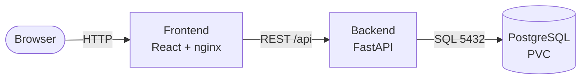
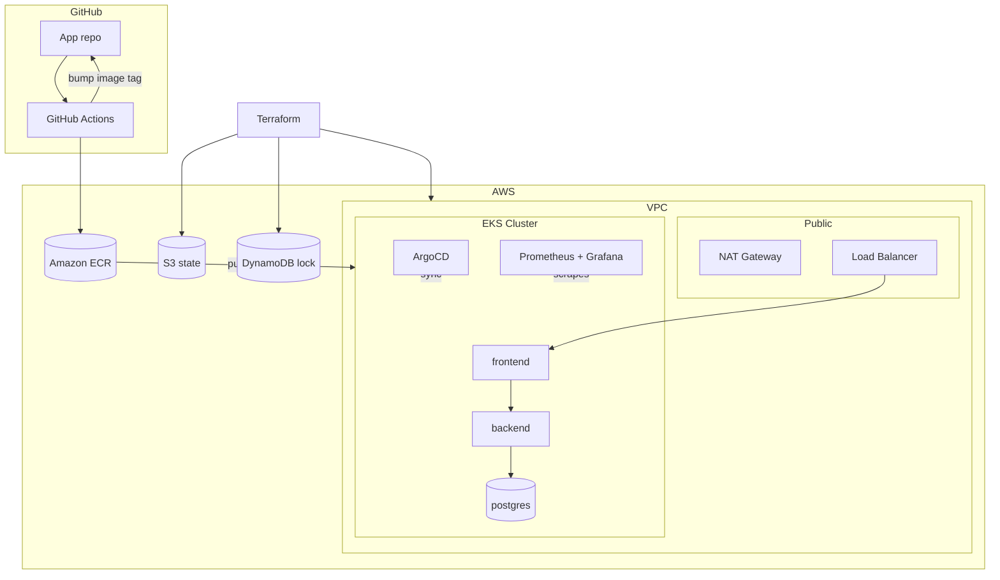

# Architecture

## Application (three tiers)

## AWS / Delivery

## Request Flow

1. Browser hits the Ingress/LoadBalancer.
2. nginx serves the React build; `/api` is proxied to the backend Service.
3. FastAPI queries PostgreSQL over the cluster network.
4. Prometheus scrapes kube-state-metrics, node-exporter, and app metrics; Grafana visualizes.

## Environments

| Env  | Terraform path   | Kustomize overlay  | Notes                       |
| ---- | ---------------- | ------------------ | --------------------------- |
| dev  | `infra/envs/dev` | `k8s/overlays/dev` | t3.medium x2, single NAT    |
| prod | `infra/envs/prod`| `k8s/overlays/prod`| larger nodes, HA, more AZs  |
