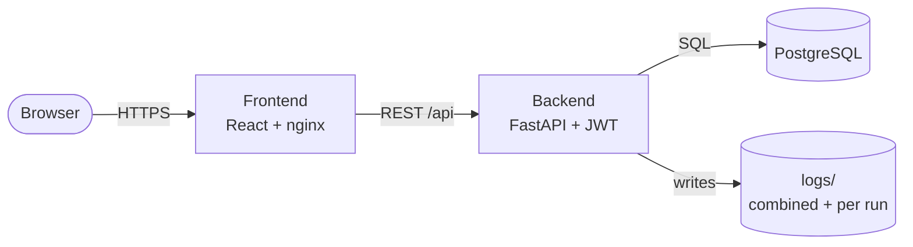
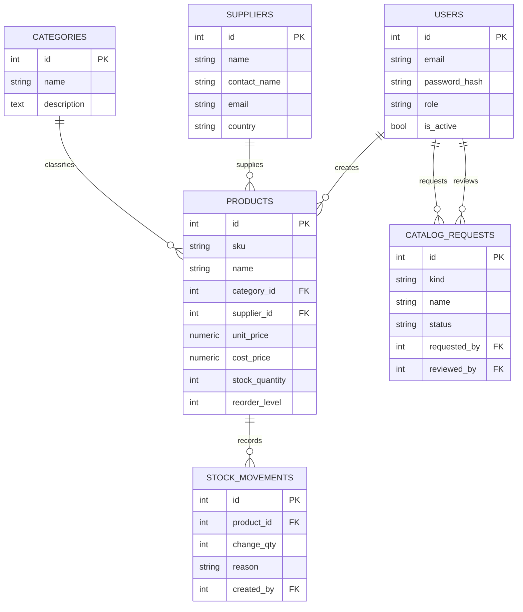
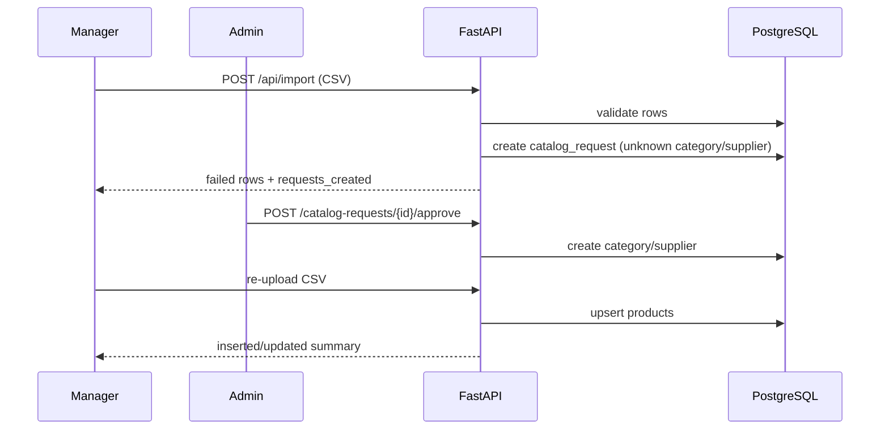
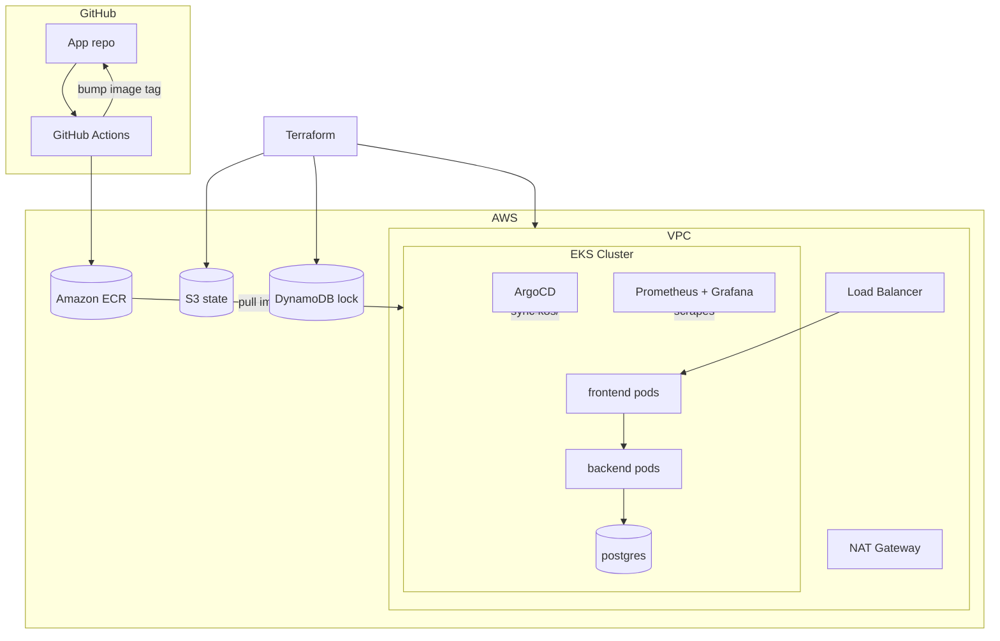

# Architecture

## Application

## Data Model

Derived values (never stored): `inventory_value = unit_price * stock_quantity`,
`is_low_stock = stock_quantity <= reorder_level`, `deficit = reorder_level - stock_quantity`.

## API Surface

| Area | Endpoints |
| --- | --- |
| Auth | `/api/auth/login`, `/api/auth/me`, `/api/auth/users` (admin) |
| Products | `/api/products` (search, filters, pagination), `/api/products/{id}/adjust` |
| Catalog | `/api/categories`, `/api/suppliers` (writes = admin) |
| Alerts | `/api/alerts/low-stock`, `/api/alerts/summary` |
| Stats | `/api/stats/summary` |
| Import | `/api/import/template`, `/api/import` |
| Approvals | `/api/catalog-requests`, `/{id}/approve`, `/{id}/reject` |

## Auth and Approval Flow

## AWS / Delivery

## Environments

| Env  | Terraform path    | Kustomize overlay  | Notes |
| ---- | ----------------- | ------------------ | ----- |
| dev  | `infra/envs/dev`  | `k8s/overlays/dev` | t3.small x2, single NAT |
| prod | `infra/envs/prod` | `k8s/overlays/prod`| larger nodes, HA, more AZs |
